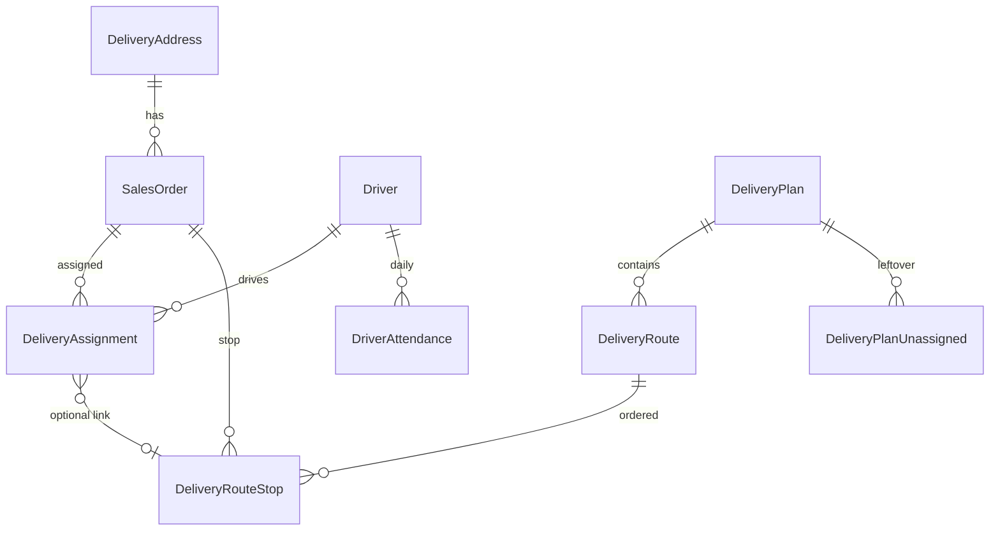

# AI 自動派單 — 資料模型

> 原則：**只做加法**。既有欄位不改型、不改 NOT NULL、不改預設語意。  
> SQL 草案見 [`database/`](./database/)（**尚未**放入正式 `database/migrations/`）。

與現有核心表關係：

---

## 1. 為何這樣設計

| 需求 | 作法 | 對現況影響 |
|------|------|------------|
| 座標 | `delivery_addresses` 新可空欄位 + status | 舊 CRUD 不讀則無感 |
| 時窗 | `sales_orders` 全可空 | 未填 = 無硬時窗 |
| 當日出勤 | 新表 `driver_attendance` | 不改 `drivers.is_active` 語意 |
| 路線草稿 | 全新 Plan／Route／Stop | 與正式 assignment 分離 |
| 發布後順序 | `delivery_assignments.route_sequence` 可空 | 無值時司機端維持舊排序 |

正式配送任務仍是 **`delivery_assignments`**；規劃結果先在草稿表，核准後才建立／更新 assignment。

---

## 2. Migration 051 — 地理、時窗、司機班表、出勤

檔案：[`051_delivery_planning_geo.sql`](./database/051_delivery_planning_geo.sql)

### 2.1 `delivery_addresses`

| 欄位 | 型別 | 預設 | 說明 |
|------|------|------|------|
| `latitude` | DECIMAL(10,7) NULL | NULL | WGS84 |
| `longitude` | DECIMAL(10,7) NULL | NULL | WGS84 |
| `geocode_status` | VARCHAR(32) NOT NULL | `'pending'` | 見下方 enum |
| `geocoded_address` | VARCHAR(500) NULL | NULL | 服務回傳正規化地址 |
| `geocoded_at` | DATETIME(3) NULL | NULL | |
| `location_accuracy` | VARCHAR(32) NULL | NULL | 供應商準確度標記 |
| `manual_location_confirmed` | TINYINT(1) NOT NULL | 0 | 管理員地圖確認 |

`geocode_status` 允許值：

- `pending` — 尚未處理（舊資料預設）
- `ok` — 自動定位可信
- `ambiguous` — 多候選，需人工
- `failed` — 失敗
- `manual_confirmed` — 人工在地圖確認

**AI 正式 publish 硬限制**：僅允許 `ok` 或 `manual_confirmed`。人工派單 API **不檢查**此欄位。

### 2.2 `sales_orders`（訂單層時窗覆寫，全可空）

| 欄位 | 型別 | 說明 |
|------|------|------|
| `delivery_window_start` | TIME NULL | 最早可送 |
| `delivery_window_end` | TIME NULL | 最晚可送 |
| `preferred_time_note` | VARCHAR(200) NULL | 文字偏好 |
| `service_duration_minutes` | INT UNSIGNED NULL | 預估服務分鐘；NULL 用系統預設規則 |
| `allow_early_delivery` | TINYINT(1) NULL | |
| `allow_late_delivery` | TINYINT(1) NULL | |
| `time_window_priority` | VARCHAR(16) NULL | `required` \| `preferred` |

未填任何時窗欄位 = 現況（僅有 `scheduled_delivery_date`）。

### 2.3 `drivers`（可空班表／depot／偏好）

| 欄位 | 型別 | 說明 |
|------|------|------|
| `work_start_time` | TIME NULL | 預設上班 |
| `work_end_time` | TIME NULL | 預設下班 |
| `depot_latitude` | DECIMAL(10,7) NULL | 個人出發點；NULL 用系統倉庫 |
| `depot_longitude` | DECIMAL(10,7) NULL | |
| `familiar_zone_ids_json` | JSON NULL | AddressZone id 陣列 |
| `can_high_floor` | TINYINT(1) NULL | NULL=未設定（軟條件） |

既有 `max_order_count`、`max_barrel_qty`、`is_active` **不變**。

### 2.4 新表 `driver_attendance`

| 欄位 | 說明 |
|------|------|
| `id` | PK |
| `driver_id` | FK → drivers |
| `work_date` | DATE |
| `is_on_duty` | 當日是否出勤 |
| `work_start_time` / `work_end_time` | 可覆寫司機預設 |
| `note` | |
| UNIQUE(`driver_id`, `work_date`) | |

---

## 3. Migration 052 — 設定與稽核

檔案：[`052_delivery_planning_settings.sql`](./database/052_delivery_planning_settings.sql)

### 3.1 `delivery_planning_settings`

Key-value（倉庫座標、預設權重版本等）：

| 欄位 | 說明 |
|------|------|
| `setting_key` | PK，如 `depot.lat`、`weights.v1` |
| `setting_value` | TEXT／JSON 字串 |
| `updated_at` / `updated_by_user_id` | |

### 3.2 `delivery_planning_audit_logs`

| 欄位 | 說明 |
|------|------|
| `id` | PK |
| `plan_id` | 可空（parse 無 plan 時） |
| `action` | `parse_constraints` \| `optimize` \| `reoptimize` \| `publish` \| `cancel` \| … |
| `model_version` | OpenAI 模型名 |
| `prompt_version` | 提示詞版本字串 |
| `input_summary` | JSON，**最小化個資**（orderNo、條件，避免姓名電話） |
| `output_summary` | JSON |
| `actor_user_id` | |
| `created_at` | |

---

## 4. Migration 053 — 路線方案（MVP-B）

檔案：[`053_delivery_planning_plans.sql`](./database/053_delivery_planning_plans.sql)

### 4.1 `delivery_plans`

| 欄位 | 說明 |
|------|------|
| `id` | PK |
| `plan_date` | 規劃配送日 |
| `version` | 同日同班遞增；未發布草稿同時只留一份（新稿會刪舊 draft） |
| `status` | `draft` \| `pending_review` \| `published` \| `cancelled` |
| `mode` | `suggest_driver` \| `full_route` |
| `algorithm_version` | 引擎／規則版本 |
| `weight_profile_key` | 對應 settings |
| `total_distance_meters` | 可空 |
| `total_drive_minutes` | 可空 |
| `unassigned_count` | |
| `created_by_user_id` | |
| `approved_by_user_id` | 可空 |
| `published_at` | 可空 |
| `compute_started_at` / `compute_finished_at` | |
| `created_at` / `updated_at` | |

### 4.2 `delivery_routes`

隸屬 plan；一位司機一條（同 plan 內）。

| 欄位 | 說明 |
|------|------|
| `plan_id`, `driver_id`, `vehicle_id` | |
| `departure_at`, `return_at` | 預估 |
| `total_distance_meters`, `total_drive_minutes`, `total_barrel_qty` | |
| `risk_score` | 可空小數 |
| `sequence_no` | 路線列表排序（非站點） |

### 4.3 `delivery_route_stops`

| 欄位 | 說明 |
|------|------|
| `route_id`, `sales_order_id` | |
| `stop_sequence` | 1-based 配送順序 |
| `eta_at`, `etd_at` | 預估抵達／離開 |
| `prev_distance_meters`, `prev_drive_minutes` | |
| `window_start`, `window_end` | 計算時快照 |
| `has_hard_violation` | 是否違反硬限制 |
| `violation_codes_json` | |
| `ai_explanation` | 派單理由（可後寫） |
| `manual_adjust_reason` | 人工拖曳原因 |

UNIQUE(`route_id`, `stop_sequence`)；UNIQUE(`plan` 層級訂單唯一) 以 (`sales_order_id` + plan 經 route) 約束——實作以 `delivery_route_stops` 上對 `sales_order_id` + 透過 route 的 plan 唯一較難，改為應用層保證，並加 `UNIQUE(route_id, sales_order_id)`。

### 4.4 `delivery_plan_unassigned`

| 欄位 | 說明 |
|------|------|
| `plan_id`, `sales_order_id` | |
| `reason_code` | 如 `NO_CAPACITY`, `NO_GEOCODE`, `TIME_WINDOW`, `NO_DRIVER` |
| `reason_text` | 人讀說明 |

### 4.5 `delivery_assignments` 可空擴充

| 欄位 | 說明 |
|------|------|
| `route_stop_id` | FK → delivery_route_stops，ON DELETE SET NULL |
| `route_sequence` | 發布時寫入的站序；NULL = 舊資料／人工派單 |

**禁止**將 `route_sequence` 設為 NOT NULL。

另見 migration 054：`assignment_shift`（`am`｜`pm`，人工舊單維持 NULL）。

---

## 4.6 Migration 054 — 班次／SLA／訂單種類

檔案：[`054_delivery_shift_dispatch.sql`](./database/054_delivery_shift_dispatch.sql)

規則說明：[05-shift-one-click.md](./05-shift-one-click.md)

| 表 | 加法 |
|----|------|
| `sales_orders` | `order_kind`、`dispatch_priority`、earliest/latest date+shift、`preferred_shift`、`dispatch_locked`、preferred/required driver |
| `driver_attendance` | `shift`（`am`｜`pm`｜`all`）；unique 改為 (driver, date, shift) |
| `delivery_plans` | `shift`；unique 改為 (date, shift, version) |
| `delivery_assignments` | `assignment_shift` 可空 |
| `delivery_planning_settings` | 班次工時／截單／SLA／巡單 ±1 |

---

## 5. Prisma 對應（實作時同步）

實作 migration 時必須同步：

1. [`apps/api/prisma/schema.prisma`](../../apps/api/prisma/schema.prisma)
2. [`database/schema.sql`](../../database/schema.sql)
3. 本目錄 SQL → 複製到 [`database/migrations/`](../../database/migrations/)

---

## 6. 與現有欄位的邊界

| 現有 | AI 規劃用法 |
|------|-------------|
| `scheduled_delivery_date` | 規劃日篩選硬條件 |
| `estimated_delivery_slot` / `estimated_delivery_at` | publish 時可填入建議時段／ETA；不刪舊語意 |
| `max_order_count` / `max_barrel_qty` | 僅 AI publish 硬擋；人工 API 第一版不 enforce |
| `AddressZone` | soft：熟悉區域／同區集中 |
| `delivery_floor` | soft：高樓層負荷 |
| `DeliveryEvent` / `OperationAuditLog` | 可續用；規劃專用稽核另表 |

---

## 7. 需求量定義（第一版）

- **Demand** = 訂單明細中出貨用途（`line_purpose = delivery`）的桶數合計（及訂單數計入 `max_order_count`）
- 重量／體積：預留未來，第一版不做多維 CVRP
