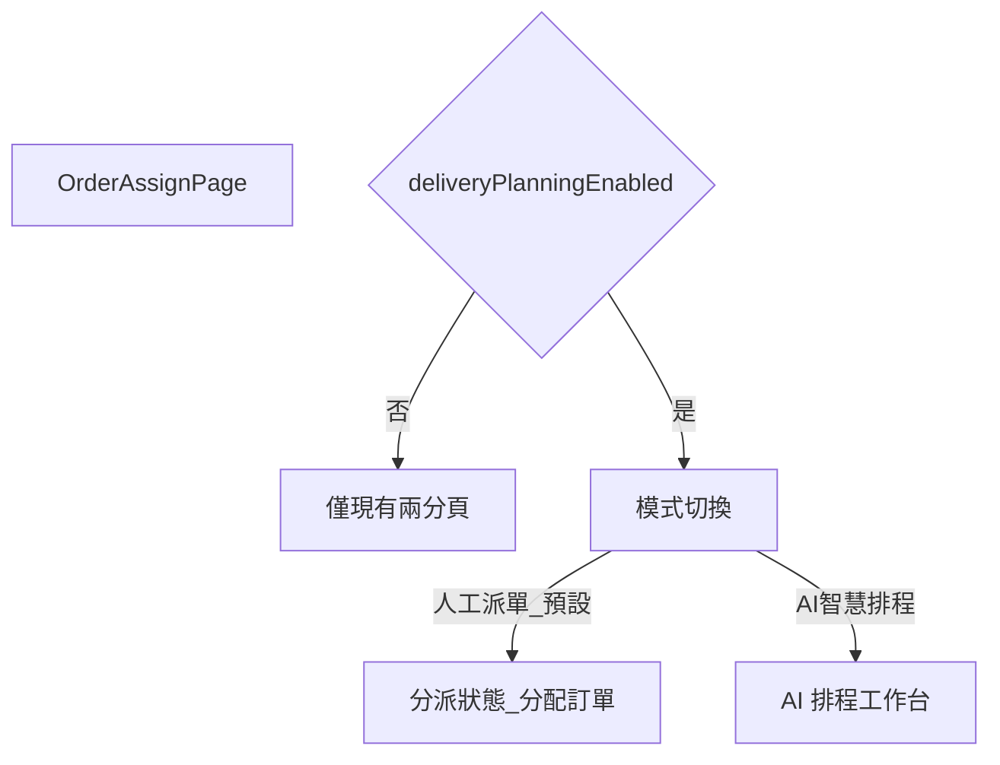

# AI 自動派單 — 後台 UI 資訊架構

> 目標：預設路徑 = **今日人工派單畫面**；AI 區塊可整塊隱藏。  
> Flag `DELIVERY_PLANNING_ENABLED=false` 或 API 回報未啟用時：**不顯示**模式切換。

---

## 1. 進入點

現有選單「派單」→ [`OrderAssignPage`](../../apps/web-admin/src/pages/OrderAssignPage.tsx)。



| 模式 | 預設 | 內容 |
|------|------|------|
| 人工派單 | **是** | 與現況相同：分派狀態 + 分配訂單 |
| 班次排程（AI） | 否 | 下方 §3：一鍵排本班；MVP-A／B 漸進顯示 |

切換到 AI 不得卸載或改寫人工分頁的 state 契約；兩模式可並存於同一 route，以條件渲染區隔。

---

## 2. 人工模式（不可破壞）

維持現有：

1. **分派狀態**（`OrderAssignmentStatusPage`）：未派／已派佇列、搜尋、勾選批次派單  
2. **分配訂單**：客戶搜尋 → 未完成訂單 → 司機當日預覽 → 單筆派單  

不在此模式強制座標、時窗或容量錯誤阻擋（與現況一致）。

---

## 3. AI 智慧排程工作台

### 3.1 頂部工具列

| 元素 | MVP-A | MVP-B |
|------|-------|-------|
| 依序：日期 → 班別 → 出勤班表（本班跑區）→ 訂單 | ✓ | ✓ |
| 快捷：今天下午／明天上午 | ✓ | ✓ |
| 本班總覽（截單／必送／缺座標／超載） | ✓ | ✓ |
| 本班司機 × 區域（主跑區／已派／草稿） | ✓ | ✓ |
| 地區訂單看板（已分配＋未分配，可篩選） | ✓ | ✓ |
| 出勤司機多選／載入該班 attendance | ✓ | ✓ |
| 模式提示：`一鍵排該班` / `建議司機` / `完整路線` | 班次一鍵 | 兩者 |
| 「一鍵排該班」→ `optimize` `shift_one_click`（可帶勾選訂單） | ✓ | ✓ |
| 「重新計算」→ `reoptimize` | 可選 | ✓ |
| 「儲存草稿」 | 自動存 DB 即可 | ✓ |
| 「確認發布」→ `publish` | ✓（僅建議司機批次派） | ✓ |
| 警示摘要：未排入／超載／缺座標 | ✓ | ✓ |

### 3.2 版面（三欄）

```text
+------------------+---------------------------+------------------+
| 左側：未派訂單池  | 中間：地圖／摘要           | 右側：司機站點   |
| 可搜尋、篩選     | MVP-A：清單／統計卡片      | 每司機一欄或手風琴 |
| 缺座標標記       | MVP-B：多色路線地圖        | 桶數／單數進度條 |
| 拖入司機（B）    | 衝突與未排入列表           | 為什麼這樣派     |
+------------------+---------------------------+------------------+
```

**MVP-A（無地圖也可上線）**

- 左：待排訂單（含 geocode／時窗狀態徽章）  
- 中：建議結果表（訂單 → 建議司機、原因摘要、未排入原因）  
- 右：每位司機建議承接的訂單列表 + 容量進度（訂單數／桶數）  
- 無拖曳地圖；允許簡單「改派到其他司機」下拉（呼叫 `PATCH .../stops` 或等價）

**MVP-B**

- 中欄地圖多色路線  
- 右側可拖曳排序／跨司機改派  
- ETA、里程、工時進度條  
- 時段衝突／超載醒目提示  

### 3.3 「為什麼這樣派」

每張訂單可展開：

- 引擎／規則摘要（容量、區域、時窗）  
- LLM 人讀說明（`explanations` API）  
- 人工調整原因（若有）

### 3.4 發布確認對話框

顯示：將建立 N 筆 assignment、將跳過 M 筆及原因；確認後才呼叫 `publish`。  
成功後提示可回到「人工派單 → 分派狀態」查看；**不自動改寫**人工頁既有操作習慣。

---

## 4. 地址確認（附屬流程）

缺座標訂單點「定位」：

1. 呼叫 geocode  
2. `ambiguous` / `failed` → 地圖點選確認 → `PATCH location` → `manual_confirmed`  
3. 未確認前：可進草稿建議，但 **publish 硬擋**

此 UI 可做獨立小頁或 modal；不阻塞人工派單。

---

## 5. 司機端（本階段僅 IA 約定）

| 階段 | 行為 |
|------|------|
| MVP-A | **不改** [`web-driver` App](../../apps/web-driver/src/App.tsx) |
| MVP-B | 若 assignment 有 `route_sequence`，依其排序；否則維持現況（多半 id 序） |
| MVP-B | 有座標時顯示「開啟導航」；無則不顯示按鈕 |

不得因缺 `route_sequence` 而無法回報／核銷。

---

## 6. 空狀態與降級

| 情況 | UI |
|------|----|
| Flag 關 | 無切換，純人工 |
| OpenAI／地圖失敗 | Toast 錯誤；保留人工模式；已開的草稿可檢視 |
| 無出勤司機 | 禁用「執行排程」，提示先設定 attendance |
| 全部未排入 | 顯示原因列表，不呼叫 publish |

---

## 7. 實作護欄（UI）

- 預設 `assignMode = 'manual'`  
- AI 相關 component 建議獨立目錄，例如 `components/delivery-planning/`，避免改壞 `OrderAssignPage` 核心流程  
- 不在人工批次派單按鈕上綁 AI 驗證  
- 樣式沿用現有 `admin-ui.css` 模式，不引入新設計系統
